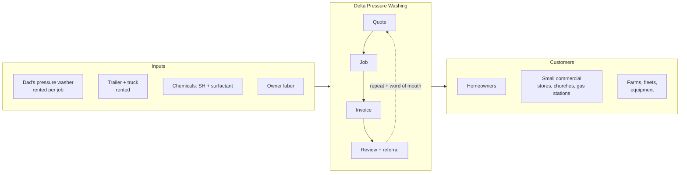

# Delta Pressure Washing — Business Plan

> Owner-operated, single-washer pressure washing business based in East Carroll Parish, Louisiana, serving the northeast Louisiana Delta and south Arkansas.

**Working name:** Delta Pressure Washing LLC (placeholder — see [Legal](plan/08-legal-and-compliance.md) for name check steps)
**Base:** Lake Providence, LA 71254
**Model:** One operator, one gas pressure washer (rented from family), one trailer, residential and light commercial jobs within ~60 miles.
**Startup capital needed:** ~$2,500 recommended (lean floor ~$1,400)
**Year 1 revenue target:** $16k part-time / $34k full-time-ish

All dollar figures are planning estimates for a rural, low cost-of-living market. Verify local items (insurance quotes, parish license fees, chemical prices) before committing.

## Table of contents

| # | Section | What's in it |
|---|---------|--------------|
| 1 | [Executive Summary](plan/01-executive-summary.md) | The business in one page, goals, why it works here |
| 2 | [Market Analysis](plan/02-market-analysis.md) | Service area, who the customers are, competition, seasonality |
| 3 | [Services & Pricing](plan/03-services-and-pricing.md) | Full price sheet, per-sqft rates, minimums, travel fees, quoting rules |
| 4 | [Equipment & Capital Requirements](plan/04-equipment-and-capital.md) | What to buy, what to rent, three startup budgets, rental deal with Dad |
| 5 | [Operations](plan/05-operations.md) | Job workflow, chemical mixes, safety, scheduling, a week in the life |
| 6 | [Financial Projections](plan/06-financials.md) | Unit economics, monthly P&L, break-even, three scenarios, cash flow |
| 7 | [Marketing & Sales](plan/07-marketing.md) | How to get the first 20 customers, Google Business, referrals, commercial accounts |
| 8 | [Legal & Compliance](plan/08-legal-and-compliance.md) | LLC, licenses, insurance, taxes, Arkansas cross-border, runoff rules |
| 9 | [Risks](plan/09-risks.md) | What can go wrong and the mitigation for each |
| 10 | [Roadmap](plan/10-roadmap.md) | 90-day launch plan, Year 1 milestones, when to add a second washer |

**Templates** (in [`templates/`](templates/)): quote sheet, job checklist, chemical mix card, rental agreement with Dad, customer intake script.

## Business at a glance

## Key numbers

| Metric | Target |
|---|---|
| Average ticket | $200–$225 |
| Target gross rate | $100–$150 per hour on the wand |
| Variable cost per job | ~15% of ticket (chem, fuel, equipment rent) |
| Fixed monthly overhead | ~$150–$200 |
| Break-even | ~1 job per month |
| Capital payback | ~12–15 jobs |
| Service radius | 30 miles core, 60 miles with travel fee |
