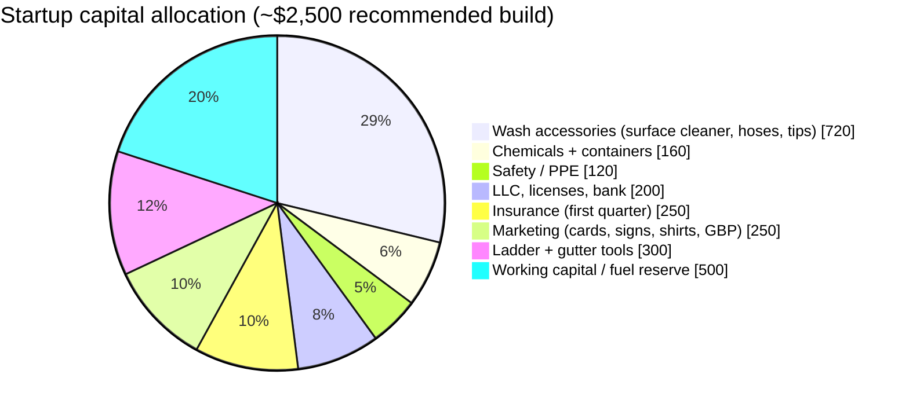

# 1. Executive Summary

## The business

Delta Pressure Washing is a one-person exterior cleaning service based in Lake Providence, East Carroll Parish, Louisiana. It will clean houses, driveways, sidewalks, storefronts, fences, decks, farm equipment, and light fleet vehicles for homeowners, small businesses, churches, and farms across the northeast Louisiana Delta and the bordering counties of south Arkansas.

The business starts deliberately small: one gas pressure washer rented from the owner's father, a rented trailer, and a truck. No employees, no shop, no debt. The owner does the quoting, the washing, the invoicing, and the marketing.

## Why this works here

- **Almost no competition inside 30 miles.** Lake Providence, Tallulah, Oak Grove, and Lake Village do not have a dedicated pressure washing company with a Google Business profile and a phone that gets answered. Most residents either drive to Monroe for a quote, hire a handyman, or do nothing.
- **The climate makes the work recurring.** Humid Delta summers grow algae, mildew, and mold on every north-facing wall, concrete pad, and vinyl fence. A house wash lasts 12–24 months, so every customer is a repeat customer.
- **Agriculture is the local economy.** Cotton, corn, soybean, rice, and catfish operations have equipment, grain bins, shop floors, and poultry/livestock buildings that need washing, and farmers already pay for services by the hour without blinking.
- **Low cost structure.** Renting the washer and trailer from family means the business can be cash-flow positive on its first job and reach capital payback in a dozen jobs.

## Goals

| Horizon | Goal |
|---|---|
| 90 days | Licensed, insured, 20 jobs completed, 10 Google reviews, 1 recurring commercial account |
| Year 1 | $16k–$34k revenue depending on hours, $2,500 capital fully paid back, own surface cleaner and all accessories |
| Year 2 | Buy own commercial washer (4 GPM+), add roof soft-washing, 2–3 recurring commercial/fleet accounts, $45k+ revenue |
| Year 3 | Decide: stay solo at $50–60k, or add a second rig and a helper |

## What the owner brings

- A pressure washer, trailer, and truck available at family rates (no capital outlay for the big-ticket items).
- Local roots: knows the parish, the churches, the farmers, the gas station owners. In a town of 3,000, that is the marketing plan.
- Low overhead and the ability to start part-time with no risk.

## The ask

This plan requires roughly **$2,500 in startup cash** (accessories, chemicals, LLC filing, insurance deposit, basic marketing) and no outside financing. See [Equipment & Capital](04-equipment-and-capital.md).

