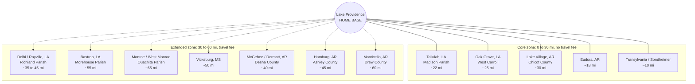
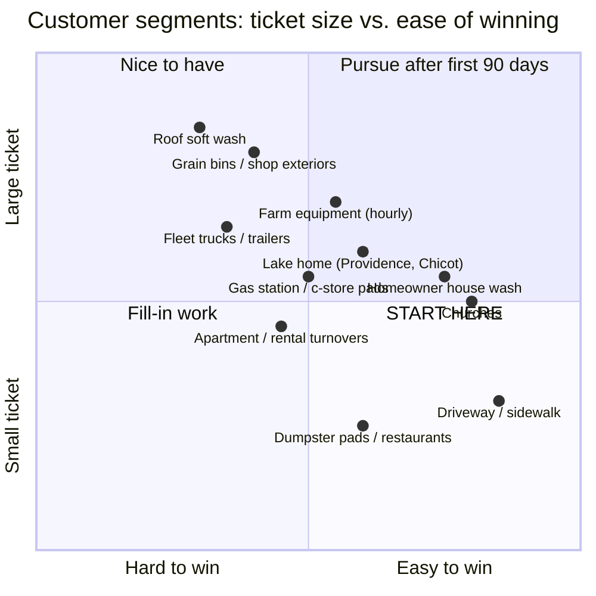
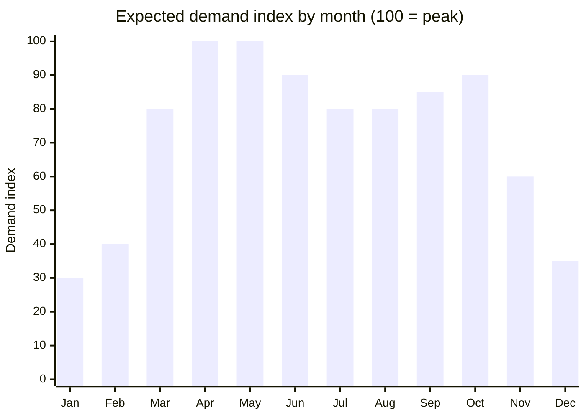

# 2. Market Analysis

## Service area

Home base is Lake Providence (East Carroll Parish). The core zone is everything within about 30 road-miles; the extended zone (with a travel fee) reaches Monroe/West Monroe, Bastrop, Monticello, and McGehee.

### Population in reach (approximate, 2020 census)

| Area | Population | Notes |
|---|---|---|
| East Carroll Parish, LA | ~7,500 | Home. Lake Providence ~3,000. Lake homes, churches, ag. |
| Madison Parish, LA (Tallulah) | ~10,000 | I-20 corridor: gas stations, truck stops, motels. |
| West Carroll Parish, LA (Oak Grove) | ~10,000 | Residential + ag. |
| Chicot County, AR (Lake Village, Eudora, Dermott) | ~10,000 | Lake Chicot homes, ag. |
| Richland Parish, LA (Rayville, Delhi) | ~20,000 | I-20 commercial. |
| Morehouse Parish, LA (Bastrop) | ~25,000 | Larger residential base. |
| Ashley County, AR (Hamburg, Crossett) | ~19,000 | Poultry houses, timber. |
| Desha / Drew County, AR | ~30,000 combined | McGehee, Dumas, Monticello. |
| Ouachita Parish, LA (Monroe) | ~160,000 | Big market, but has real competition. Treat as overflow only. |

**Roughly 130,000 people live inside the 60-mile ring outside of Monroe, with almost no dedicated pressure washing provider serving the eastern half of that ring.**

## Customer segments

### Segment notes

1. **Homeowners (60% of early revenue).** House wash + driveway bundle is the bread and butter. Median home value in the area is low ($80k–$150k), so price sensitivity is real. Lake homes and newer brick/vinyl homes are the best targets. Pitch: "makes it look new for less than a paint job."
2. **Churches (easy entry).** Every town has 5–15 churches with concrete walks, brick walls, and fellowship halls, and a deacon board that approves a $300 wash on the spot. Churches are also the referral engine in small towns.
3. **Small commercial.** Gas stations and c-stores on US-65 and I-20 (Tallulah), dollar stores, banks, clinics, and restaurants. Sell monthly or quarterly sidewalk/pad/dumpster cleaning. This is where recurring revenue comes from.
4. **Agriculture.** Farm shops, equipment before sale or storage, grain bin exteriors, cotton pickers and combines at season end, catfish operation buildings, poultry house exteriors (Ashley County). Sell hourly. Farmers in the Delta are used to paying $100+/hr for service work.
5. **Fleet.** Farm trucks, grain trailers, local trucking outfits, parish/city vehicles. Per-unit pricing, done on site in their yard.
6. **Rental/property turnovers.** Landlords in Tallulah and Lake Providence flipping units; exterior wash before listing.

## Competition

| Competitor type | Where | Weakness we exploit |
|---|---|---|
| Established pressure washing companies | Monroe / West Monroe | Charge travel to come east; won't show up for a $200 driveway in Lake Providence. |
| Handymen / lawn guys with a box-store washer | Everywhere | No insurance, no soft wash (they blast siding and strip paint), no reviews, no follow-through. |
| DIY | Everywhere | Homeowners rent a washer, do a poor job, hurt their back. Our pitch: "$175, done in 2 hours, guaranteed." |
| Nobody | Lake Providence, Oak Grove, Eudora, Lake Village | Literal absence of a Google Business listing is our biggest advantage. |

## Seasonality

- **March to June:** Spring cleaning, pollen, pre-Easter church pushes, graduation parties. Peak.
- **July to August:** Hot. Start jobs at 6:30am. Commercial and ag fill-in.
- **September to November:** Second peak. Pre-holiday house washes, post-harvest equipment washing (cotton pickers, combines, grain carts in Oct and Nov).
- **December to February:** Slow. Sodium hypochlorite still works above ~40°F. Focus on fleet, commercial, gutters, and marketing for spring.

## Pricing power

Rural Delta pricing sits at the **low-to-middle end of national ranges**. National average house wash is $250–$450; here plan on $175–$300. The volume advantage is the lack of competition, not premium pricing. Full price sheet is in [Services & Pricing](03-services-and-pricing.md).
