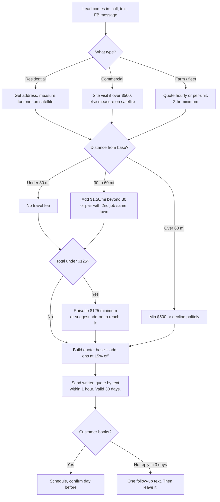

# 3. Services & Pricing

## Pricing philosophy

- **Target $100–$150 per hour of wand time.** Every price below is built so a competent solo operator hits that rate once they're practiced. Early jobs will run slower; do not lower the price, get faster.
- **Price per square foot, quote in round numbers.** Measure with a free satellite tool (Google Earth, or the measuring feature in Google Maps) before you drive out. Quote over the phone for standard jobs; only site-visit for commercial or anything over $500.
- **Minimum ticket: $125** inside the core zone. It costs the same to hook up and drive out for a $60 sidewalk as for a $250 house.
- **Bundle aggressively.** House + driveway together is the money job. Discount the add-on 15–20%, never the main service.
- **Rural market reality.** These prices are 20–35% below what the same work brings in Monroe, Jackson, or Little Rock. That's correct for this market. Raise prices 10% once you're booked two weeks out.

## Service menu and price sheet

### Residential

| Service | Unit | Rate | Typical job | Typical price | Est. wand time |
|---|---|---|---|---|---|
| House soft wash, 1 story | sq ft of footprint | $0.10–$0.13 | 1,600 sq ft brick or vinyl | **$175–$225** | 1.5–2 hr |
| House soft wash, 2 story | sq ft of footprint | $0.14–$0.18 | 2,200 sq ft | **$300–$400** | 2.5–3.5 hr |
| Driveway | sq ft | $0.15–$0.20 | 2-car, 20×40 = 800 sq ft | **$125–$160** | 1 hr |
| Sidewalk / walkway | sq ft | $0.18–$0.25 | 4×60 = 240 sq ft | **$75 (as add-on)** | 20 min |
| Patio / pool deck | sq ft | $0.18–$0.25 | 400 sq ft | **$90–$110** | 40 min |
| Wood fence (both sides) | linear ft | $1.00–$1.50 | 150 lf privacy fence | **$150–$225** | 1.5–2 hr |
| Vinyl fence | linear ft | $0.75–$1.00 | 150 lf | **$115–$150** | 1 hr |
| Deck wash (no sealing) | sq ft | $0.75–$1.25 | 300 sq ft | **$225–$300** | 1.5–2 hr |
| Gutter exterior brightening (add-on) | linear ft | $1.00–$1.50 | 160 lf | **$160–$200** | 1 hr |
| Gutter clean-out (interior, debris) | linear ft | $1.00–$1.25 | 160 lf | **$160–$200** | 1–1.5 hr |
| Carport / metal awning | flat | — | Standard 2-car | **$75–$125** | 45 min |
| Mobile home / manufactured home wash | flat | — | Single-wide / double-wide | **$125 / $175** | 1–1.5 hr |
| Boat hull / pontoon (out of water) | flat | — | 18–24 ft | **$100–$175** | 1 hr |
| Roof soft wash (Year 2, after training) | sq ft | $0.25–$0.40 | 2,000 sq ft shingle | **$500–$700** | 2–3 hr |

### Commercial

| Service | Unit | Rate | Typical price |
|---|---|---|---|
| Storefront sidewalk + entry | sq ft | $0.12–$0.18 | $100–$250 |
| Gas station pump pad + islands | flat per pad | — | $200–$400 |
| Dumpster pad + enclosure | flat | — | $75–$125 (monthly: $60) |
| Drive-thru lane (grease, gum) | sq ft | $0.18–$0.25 | $150–$300 |
| Building exterior (1 story metal/brick) | sq ft of wall | $0.12–$0.18 | $300–$800 |
| Church: walks + entry + fellowship hall wall | package | — | $250–$450 |
| Parking lot (surface cleaner, no striping) | sq ft | $0.08–$0.12 | $400+ (only with 20"+ surface cleaner) |
| Monthly maintenance contract (sidewalks + pad + dumpster) | per visit | — | $125–$200 at a 20% discount to one-off |

### Agriculture and fleet

| Service | Unit | Rate | Notes |
|---|---|---|---|
| Farm equipment / shop / bins, hourly | hour (2-hr min) | **$95–$125/hr + chemicals** | The only hourly service. Farmers expect hourly. Bill degreaser at cost + 25%. |
| Combine / cotton picker / sprayer wash-down | per machine | $200–$400 | Pre-storage or pre-sale. Post-harvest Oct–Nov. |
| Tractor | per unit | $75–$150 | |
| Grain bin exterior (soft wash) | per bin | $150–$400 | Depends on height; no climbing, use extension wand. |
| Poultry / livestock house exterior | per house | $250–$500 | Ashley County. Exterior only. |
| Pickup / farm truck | per unit | $40–$60 | Volume: 5+ trucks in a yard. |
| Semi tractor | per unit | $60–$90 | |
| Grain trailer / flatbed / hopper | per unit | $75–$125 | |
| Fleet, monthly on-site | per unit | 15% off list | Minimum 5 units per visit. |

## Travel and surcharges

| Item | Rule |
|---|---|
| Core zone (0–30 road miles from Lake Providence) | No travel fee |
| Extended zone (30–60 miles) | **$1.50 per mile beyond 30**, one way. Example: Bastrop at 55 mi = $37.50. Waived on any job over $400 or if two jobs are booked in the same town. |
| Beyond 60 miles | Quote-only, minimum $500 ticket |
| No water on site (farms, vacant property) | +$40 (uses hauled water tank; see equipment) |
| Heavy prep (oil stains, rust, gum, paint overspray) | +$25–$75 quoted on inspection, or hourly |
| Same-day / emergency | +25% |
| Weekend commercial (store wants it done closed) | +15% |

## Bundles (the real menu)

| Bundle | Includes | Price | vs. separately |
|---|---|---|---|
| **"Curb Appeal"** | 1-story house wash + driveway + front walk | **$275** | ~$340 |
| **"Whole Yard"** | House + driveway + walks + patio + fence (up to 100 lf) | **$450** | ~$560 |
| **"Church Sunday-Ready"** | Entry walks, steps, front wall, sign | **$300** | ~$375 |
| **"Store Front"** (monthly) | Sidewalk, entry, dumpster pad | **$150/mo** | ~$190 |
| **"Harvest Wrap-Up"** | Combine or picker + 2 tractors + grain cart | **$550** | ~$700 |

## Quoting decision tree

## Example quotes

**Example 1: 1,500 sq ft brick ranch in Lake Providence, 2-car driveway, 40 ft walk**
- House: 1,500 × $0.12 = $180
- Driveway: 800 × $0.16 = $128 → add-on 15% off = $109
- Walk: 160 × $0.20 = $32 → add-on = $27
- **Quote: $315, round to $300 "Curb Appeal Plus."** Est. 3 hours on site. $100/hr.

**Example 2: Dollar store in Tallulah, monthly**
- Sidewalk 8 × 120 = 960 sq ft × $0.14 = $134
- Dumpster pad $75
- One-off total $209; monthly contract at $165. Est. 1.25 hr. $132/hr.

**Example 3: Farm shop in Chicot County, AR, wash a combine and 2 tractors before storage, no water hookup near the shop**
- 4 hours × $110 = $440
- Degreaser 2 gal at $12 + 25% = $30
- No-water surcharge $40
- Travel 32 mi: 2 mi × $1.50 = $3 → waive
- **Quote: $510.** Easy sell in November.

## Payment terms

- Residential: due on completion. Cash, check, Zelle, Cash App, or card (Square, 2.6% + 10¢). Take a photo of the finished job before leaving.
- Commercial/ag: Net 15 by invoice, 50% deposit on anything over $750. Add 1.5%/month late fee on the invoice (you won't collect it, but it gets you paid faster).
- Never start a residential job over $500 without a $100 deposit.

## Sales tax note

Louisiana generally does not tax labor for cleaning real property, but Arkansas taxes several cleaning services (parking lot and gutter cleaning are listed). See [Legal & Compliance](08-legal-and-compliance.md) before quoting commercial work across the river. When in doubt, quote "plus applicable sales tax."
