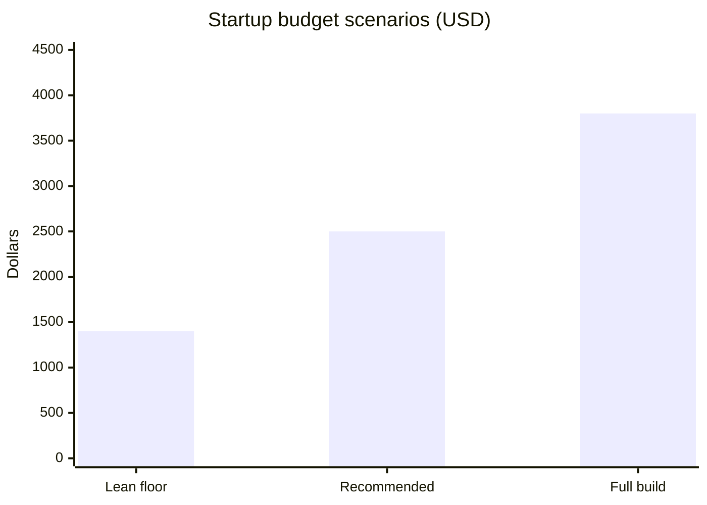
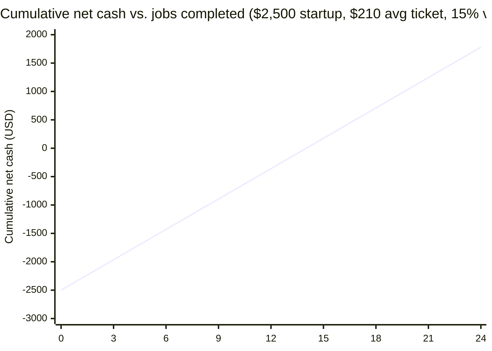

# 4. Equipment & Capital Requirements

## What you already have access to

| Asset | Source | Arrangement | Notes |
|---|---|---|---|
| Gas pressure washer | Dad | Rent per job or per month | Confirm specs: need **at least 3,000 PSI and 2.5 GPM**; 4 GPM is the real workhorse. GPM matters more than PSI for cleaning speed. If it's a box-store 2.3 GPM unit, driveways will take twice as long; price accordingly and plan the upgrade in Year 2. |
| Trailer | Own / rent | Rent to the LLC | Any 5×8 or larger utility trailer works. Needs a way to strap the washer and a 65-gal tank. |
| Truck | Possibly available | Rent per mile to the LLC | If not available, the washer and gear fit in a pickup bed without the trailer. |

**Get the washer's exact make, model, PSI, GPM, and pump type (axial vs. triplex) before buying tips and the surface cleaner.** Surface cleaners are sized to GPM; a 20" cleaner on a 2.5 GPM washer will leave stripes.

## Startup equipment list

### Required (buy before first job)

| Item | Purpose | Low | Recommended | Source |
|---|---|---|---|---|
| Surface cleaner, 15–20" | Driveways, walks, pads. Single biggest speed multiplier. | $130 | $250 | Pressure washer supply stores online; match to GPM |
| 100 ft pressure hose, 3/8", 4,000 PSI | Reach the back of a house without moving the washer | $90 | $130 | Online |
| 100–150 ft 5/8" garden hose + quick connects | Supply | $50 | $80 | Hardware store |
| Nozzle tip set (0°, 15°, 25°, 40°, soap) + spare | Everything | $20 | $30 | Online |
| Turbo nozzle | Grease, rust, stubborn concrete | $30 | $45 | Online |
| Downstream chemical injector + 10 ft chem hose + filter | Pull sodium hypochlorite mix through the washer for soft washing | $25 | $45 | Online |
| Soft-wash J-rod with 4 soap nozzles | Apply chem to 2-story siding from the ground | $30 | $40 | Online |
| 18–24 ft telescoping wand (or 6 ft extension wand) | Second story, gutters, bins | $60 | $110 | Online |
| Sodium hypochlorite 12.5%, 10 gal | The soft-wash chemical. Pool supply or chemical distributor. | $45 | $55 | Pool supply (Monroe/Vicksburg), ag chem dealer |
| Surfactant (soap that makes SH cling), 1 gal | Mixed with SH | $35 | $45 | Online pressure wash supply |
| Degreaser, 1 gal concentrate | Fleet, shop floors, pads | $20 | $30 | Auto parts / online |
| Two 5-gal chem buckets with lids, measuring cup, funnel | Mixing | $20 | $30 | Hardware store |
| Garden pump sprayer, 2 gal | Pre-treat spots, plant rinse | $25 | $35 | Hardware store |
| PPE: chemical respirator (half-mask + cartridges), goggles, rubber boots, nitrile gloves, long sleeves | Not optional. SH burns lungs and eyes. | $90 | $130 | Hardware / safety supply |
| First aid kit, eyewash bottle | | $20 | $30 | |
| Tarp / plastic sheeting, spring clamps | Cover plants, electrical panels, outlets | $20 | $30 | |
| Pump oil, spare o-rings, quick-connect fittings, Teflon tape | Field repairs | $25 | $40 | |
| 5-gal gas can | Washer fuel | $20 | $25 | |
| **Subtotal: required gear** | | **$755** | **$1,180** | |

### Strongly recommended (buy within first month)

| Item | Purpose | Cost |
|---|---|---|
| 24 ft extension ladder (aluminum, Type I) | Gutters, 2-story eaves. Don't wash from a ladder; use it to reach. | $220–$280 |
| Gutter clean-out attachment | Gutter interior jobs | $25 |
| Hose reel (manual) for pressure hose | Saves 10 min per job and your hose | $60–$90 |
| 65-gal water tank + 12V transfer pump + battery | Farm and vacant-property jobs with no spigot. Adds the $40 no-water surcharge line. | $230–$300 |
| Magnetic truck signs or vinyl trailer lettering | Rolling advertisement | $80–$150 |
| **Subtotal** | | **$615–$845** |

### Optional / Year 2

| Item | Why wait |
|---|---|
| Own 4 GPM belt-drive washer ($1,500–$2,500) | Buy once revenue proves the business; use Dad's until then |
| 12V soft-wash pump system for roofs ($400–$700) | Roofs need training and higher insurance; not a Year 1 service |
| Second surface cleaner / 2-man setup | Only with a second person |
| Enclosed trailer ($3,000+) | Only when you want to leave gear loaded and locked |

## Business setup costs

| Item | Cost | Notes |
|---|---|---|
| Louisiana LLC filing (geauxBIZ) | $100 | Plus ~$5 online fee. Annual report $30/yr after. |
| EIN (IRS) | $0 | Online, 10 minutes. Never pay for this. |
| Parish / town occupational license | $50–$100 | East Carroll Parish Police Jury and/or Town of Lake Providence. Ask the tax assessor's office. |
| Business checking account | $0 | Local bank or credit union. Keep it separate from day one. |
| General liability insurance, $1M/$2M | $45–$90/month | Budget $250 for the first quarter. Quote Next, Thimble, Hiscox, and a local Farm Bureau or independent agent. See Legal section. |
| Domain + Google Business Profile | $15 | GBP is free. Domain is optional but cheap. |
| Business cards (500), yard signs (10), door hangers (250) | $150–$200 | Vistaprint or local printer |
| 3 work shirts with logo | $60 | |
| Invoicing/quoting app | $0 | Square or Wave are free; Jobber ($40+/mo) once you have 15+ jobs a month |
| **Subtotal** | **$620–$770** | |

## Three startup budgets

| Scenario | What's in it | Total |
|---|---|---|
| **Lean floor** | Required gear at low prices, LLC, license, one month insurance, cards only, $200 reserve. No ladder, no tank. Borrow a ladder. | **~$1,400** |
| **Recommended** | Required gear at recommended prices, ladder, hose reel, LLC, license, insurance quarter, full marketing kit, $500 reserve | **~$2,500** |
| **Full build** | Everything above plus water tank system, truck signs, enclosed-trailer-ready fit-out, $700 reserve | **~$3,800** |

**Go with Recommended.** The lean build works but you'll spend the first month wishing you'd bought the ladder and hose reel.

## The rental deal with Dad

Put it in writing (a one-page agreement is in [`templates/equipment-rental-agreement.md`](../templates/equipment-rental-agreement.md)). It protects both of you and makes the rent a clean deductible business expense. Three options, pick one:

| Structure | Washer | Trailer | Truck | Best when |
|---|---|---|---|---|
| **A. Per job** | $25/job | $10/job | $0.50/mile | Starting part-time, under 10 jobs/mo |
| **B. Flat monthly** | $150/mo | $50/mo | $0.50/mile | 10+ jobs/mo |
| **C. Revenue share** | 10% of job revenue covers washer + trailer | — | $0.50/mile | Dad wants upside, you want zero fixed cost |

Whichever you pick, the LLC should also:
- Pay for washer fuel, pump oil, and any repair caused by your use.
- Keep the washer listed on your general liability policy as "non-owned equipment" if the insurer asks.
- Plan to buy your own washer within 12–18 months so Dad gets his back.

At Option A and 8 jobs/month, equipment rent is ~$280/month, about 15% of revenue. That's a fair price for not spending $2,000 on a washer up front.

## Capital payback

Roughly **14 average jobs** returns the full recommended startup budget. At 2 jobs a week that's 7 weeks.
