# 5. Operations

## Job workflow

```mermaid
flowchart LR
    subgraph Before["Day before"]
        A[Confirm by text:<br/>time, water on, cars moved,<br/>windows closed, pets inside]
        B[Load trailer: washer, hoses,<br/>surface cleaner, chem, PPE, ladder]
        C[Mix SH batch for the day]
    end
    subgraph OnSite["On site"]
        D[Walk the property with customer.<br/>Note existing damage, take BEFORE photos]
        E[Protect: wet down plants,<br/>cover outlets and panels,<br/>close windows]
        F[Apply chem low to high,<br/>dwell 5 to 10 min,<br/>never let it dry]
        G[Rinse high to low.<br/>Surface-clean flatwork.<br/>Rinse plants again]
        H[Final walk with customer.<br/>AFTER photos. Collect payment.]
    end
    subgraph After["Same evening"]
        I[Send invoice/receipt<br/>+ review link]
        J[Post before/after to Facebook]
        K[Log job: address, sq ft, time,<br/>chem used, price, notes]
        L[Flush injector, drain pump,<br/>restock chem]
    end
    Before --> OnSite --> After
```



## Standard operating procedures

### House soft wash (vinyl, brick, stucco, painted wood, Hardie)

1. **Never** use high pressure on siding. Soft wash = chemical does the work, rinse at garden-hose-plus pressure (40° tip or soap tip, held 2+ ft back).
2. Pre-wet all plants and grass within 10 ft of the wall. Cover delicate shrubs with a tarp.
3. Mix: downstream injector pulls roughly 1 part chem to 10 parts water. Bucket mix for house wash: **1 gal 12.5% SH + 4 gal water + 2 oz surfactant** (gives ~1% SH at the wall after injector dilution). For heavy green/black mildew, go to 2 gal SH per bucket.
4. Apply bottom to top so streaks don't set. Let dwell 5–10 minutes. Reapply to stubborn spots. Do not let it dry on the surface.
5. Rinse top to bottom with plain water. Rinse windows last and thoroughly (SH spots glass).
6. Rinse plants and grass again. Neutralize heavy overspray on plants with a hose.
7. Oxidized vinyl and aluminum will streak if you rub it. Chem and rinse only; warn the customer beforehand that oxidation is not dirt.

### Concrete (driveways, walks, pads)

1. Pre-treat with SH mix (same bucket) at 1:10 for organic staining. Degreaser on oil spots, let dwell 10 min.
2. Surface cleaner in overlapping passes at a steady walking pace. Overlap 50%. Don't stop moving or you'll etch a ring.
3. Edge with a 25° tip. Rinse all debris into the yard, not the street drain.
4. Post-treat with a light SH mix to kill spores and keep it bright longer (sell this as "treated to stay clean").
5. Note: soft or old concrete can scar. Test a spot in a corner first.

### Fences and decks

- Wood: 15° or 25° tip at 500–1,200 PSI equivalent (back off distance), always with the grain, never stop moving. Low-pressure SH pre-treat does most of the work.
- Vinyl: soft wash only.
- Decks: sell the wash; refer out the sealing until Year 2.

### Farm equipment and fleet

- Degreaser first on engine bays and undercarriages, dwell, then high pressure with 15° tip. Turbo nozzle on caked mud.
- Keep water out of air intakes, electrical boxes, and bearings. Ask the farmer what to avoid.
- Bill hourly. Start the clock when the first hose is unrolled.

## Chemical safety

| Rule | Why |
|---|---|
| Respirator and goggles whenever spraying SH | Chlorine vapor damages lungs; splashback blinds |
| Never mix SH with anything but water and surfactant | SH + ammonia or acid = toxic gas |
| Store SH in a shaded, ventilated spot; it degrades in heat | Loses strength in weeks in a hot truck |
| Label every container | Legal requirement and basic safety |
| Keep an SDS sheet for every chemical in the truck | OSHA, and you'll want it if someone gets splashed |
| Rinse any overspray off vehicles, windows, and metal immediately | SH pits aluminum and spots glass |

## Water and runoff

- Wash water from a house wash is mostly diluted bleach and dirt; rinse it into the grass, not the storm drain.
- Commercial sites with grease or oil (gas stations, drive-thrus) can fall under Clean Water Act rules on discharge to storm drains. Use a drain cover or berm and direct runoff to landscaping, or vacuum it. Price that time in.
- Don't pull water from a customer's well without asking; some Delta wells have low recovery.

## Scheduling

- **Peak season:** Mon–Sat, first job 7:00am in summer. Two to three jobs a day is the ceiling for one person.
- **Route by town.** Book Tallulah jobs together on the same day, Chicot County jobs together, etc. Travel is the biggest hidden cost.
- **Rain:** Light rain is fine for concrete; cancel house washes (chem won't dwell). Have a rain-day list of fleet and shop jobs under cover.
- **Buffer:** Leave 45 minutes between jobs for drive time and the inevitable "while you're here, can you also..."

## A week in the life (full-time, peak season)

```mermaid
gantt
    title Sample peak-season week (one operator)
    dateFormat  YYYY-MM-DD
    axisFormat  %a
    section Mon
    Lake Providence: house + driveway   :a1, 2026-04-06, 1d
    section Tue
    Tallulah: 2 commercial sidewalks, 1 church     :a2, 2026-04-07, 1d
    section Wed
    Oak Grove: house, fence, patio      :a3, 2026-04-08, 1d
    section Thu
    Lake Village AR: lake house + dock + boat    :a4, 2026-04-09, 1d
    section Fri
    Farm shop Chicot Co: 4 hrs equipment, then quotes   :a5, 2026-04-10, 1d
    section Sat
    Two Lake Providence driveways, half day     :a6, 2026-04-11, 1d
```

That week is roughly 9 jobs and $2,100–$2,500 in revenue. Sustain it for the 30 peak weeks and that is the moderate scenario in [Financials](06-financials.md).

## Records to keep

- **Job log** (spreadsheet): date, customer, address, services, sq ft, price, time on site, chem used, payment method, photos link. This becomes your pricing calibration tool.
- **Mileage log**: every business mile. Worth ~$0.70/mile as a deduction (IRS rate changes yearly).
- **Receipts**: photograph every receipt into a folder by month.
- **Customer list**: name, phone, address, last service date. Text them at 12 months: "Ready for a refresh?"
