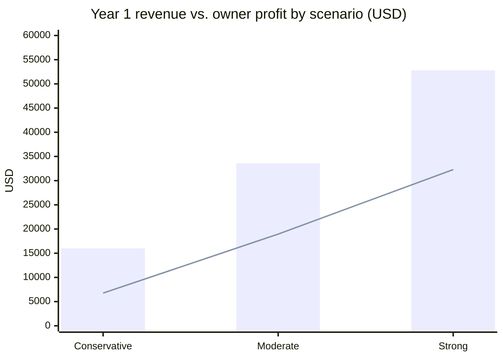
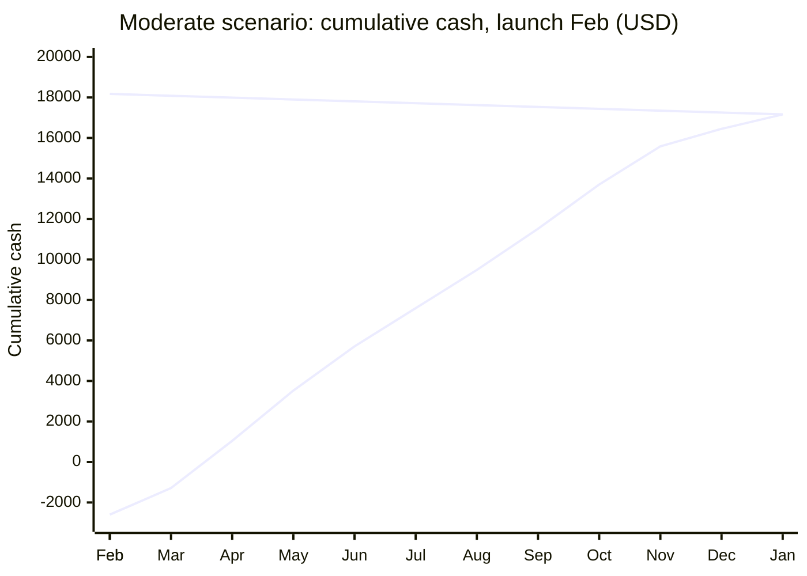
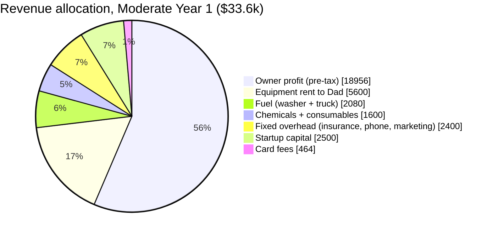

# 6. Financial Projections

All figures are planning estimates. Build the real version in a spreadsheet from your job log after the first 20 jobs.

## Unit economics (one average job)

| Line | Amount | Notes |
|---|---|---|
| Average ticket | **$210** | Blend of $160 driveways, $225 houses, $300 bundles, $400 farm/commercial |
| Chemicals | $8 | ~1.5 gal SH + surfactant |
| Washer fuel | $6 | ~1.5 gal gas |
| Truck fuel (avg 30 mi round trip) | $7 | |
| Equipment rent to Dad (Option A) | $35 | $25 washer + $10 trailer |
| Card fees (half of customers) | $3 | |
| Consumables (tips, o-rings, water) | $2 | |
| **Variable cost per job** | **$61 (29%)** | Drops to ~15% once you own the washer |
| **Gross profit per job** | **$149** | |
| Time per job incl. drive and setup | 2.75 hr | |
| **Gross profit per hour** | **$54/hr** | After buying own washer: ~$65/hr |

## Fixed monthly overhead

| Item | Monthly |
|---|---|
| General liability insurance | $65 |
| Phone (business line or share of personal) | $25 |
| Software (Square free; Jobber later) | $0–$45 |
| Google Business / website / domain | $5 |
| Marketing (door hangers, boosted FB posts) | $50 |
| Bank, misc | $10 |
| **Total fixed** | **~$155–$200** |

**Break-even is about 1.3 jobs per month.** Everything after that is profit and owner pay.

## Three Year-1 scenarios

| | Conservative (part-time) | Moderate (near full-time) | Strong |
|---|---|---|---|
| Jobs per week (avg over 40 working weeks) | 2 | 4 | 6 |
| Jobs per year | 80 | 160 | 240 |
| Average ticket | $200 | $210 | $220 |
| **Revenue** | **$16,000** | **$33,600** | **$52,800** |
| Variable costs (29%) | $4,640 | $9,744 | $15,312 |
| Fixed costs | $2,100 | $2,400 | $2,700 |
| Startup capital (expensed) | $2,500 | $2,500 | $2,500 |
| **Pre-tax owner profit** | **$6,760** | **$18,956** | **$32,288** |
| Hours worked (2.75/job + 4 hr/wk admin) | 380 | 600 | 820 |
| **Effective hourly** | **$18** | **$32** | **$39** |
| Self-employment tax reserve (set aside 25%) | $1,700 | $4,700 | $8,100 |

The Strong scenario requires buying your own 4 GPM washer mid-year (the rented unit will bottleneck at 6 jobs/week), which bumps capital by ~$2,000 but cuts variable cost to ~15%.

## Monthly cash flow, Moderate scenario, Year 1

Launch assumed in **March** so the first full month lands at the start of peak season. Jobs follow the seasonality index from the market section.

| Month | Jobs | Revenue | Variable | Fixed | Capex | Net cash | Cumulative |
|---|---|---|---|---|---|---|---|
| Feb (setup) | 0 | $0 | $0 | $100 | $2,500 | -$2,600 | -$2,600 |
| Mar | 10 | $2,100 | $610 | $180 | $0 | $1,310 | -$1,290 |
| Apr | 17 | $3,570 | $1,037 | $200 | $0 | $2,333 | $1,043 |
| May | 18 | $3,780 | $1,098 | $200 | $0 | $2,482 | $3,525 |
| Jun | 16 | $3,360 | $976 | $200 | $0 | $2,184 | $5,709 |
| Jul | 14 | $2,940 | $854 | $200 | $0 | $1,886 | $7,595 |
| Aug | 14 | $2,940 | $854 | $200 | $0 | $1,886 | $9,481 |
| Sep | 15 | $3,150 | $915 | $200 | $0 | $2,035 | $11,516 |
| Oct | 16 | $3,360 | $976 | $200 | $0 | $2,184 | $13,700 |
| Nov | 14 | $2,940 | $854 | $200 | $0 | $1,886 | $15,586 |
| Dec | 7 | $1,470 | $427 | $180 | $0 | $863 | $16,449 |
| Jan | 6 | $1,260 | $366 | $180 | $0 | $714 | $17,163 |
| Feb | 8 | $1,680 | $488 | $180 | $0 | $1,012 | $18,175 |
| **Total (13 mo)** | **155** | **$32,550** | **$9,455** | **$2,420** | **$2,500** | **$18,175** | |

**Cash goes positive in month 2 of operations.** That is the whole argument for renting the washer instead of buying one.

## Where the money goes (Moderate, Year 1)

## Sensitivity: what moves the number

| Lever | Change | Effect on Moderate profit |
|---|---|---|
| Average ticket +$25 (better bundling) | $210 → $235 | **+$4,000** |
| One more job per week | 4 → 5 | **+$6,000** |
| Buy own washer at month 6 (cuts rent) | | +$2,800 net of purchase in Year 1, +$5,600/yr after |
| Travel fee waived too often | | -$1,500 |
| Two recurring commercial accounts at $165/mo | | +$3,960 and smooths the winter |
| Winter drops to zero (no fleet/commercial work) | | -$2,600 |

## Year 2–3 outlook

| | Year 2 | Year 3 (solo) | Year 3 (add helper + 2nd rig) |
|---|---|---|---|
| Jobs | 220 | 260 | 420 |
| Avg ticket (adds roofs, more commercial) | $240 | $260 | $260 |
| Revenue | $52,800 | $67,600 | $109,200 |
| Variable cost % (own washer) | 15% | 15% | 18% |
| Labor (helper, $18/hr × 1,200 hr) | — | — | $21,600 |
| Fixed overhead | $3,600 | $4,200 | $7,200 |
| Capex | $2,500 (washer) | $1,000 | $6,000 (rig) |
| **Owner profit** | **$38,780** | **$52,260** | **$54,744** |

Adding a helper in Year 3 roughly doubles revenue but only marginally increases profit until the second rig is fully booked. Stay solo until you're turning away work weekly.

## Taxes (set money aside)

- LLC with one owner is taxed as a sole proprietorship by default: Schedule C on your 1040, plus 15.3% self-employment tax.
- **Set aside 25% of every payment** in a separate savings account. Pay quarterly estimates (April, June, September, January) to avoid penalties.
- Deductible: equipment rent to Dad, chemicals, fuel, mileage, insurance, phone share, marketing, the surface cleaner and gear (Section 179 or de minimis expensing).
- Once net profit passes ~$40k, ask a CPA about an S-corp election to trim SE tax. Not before.
