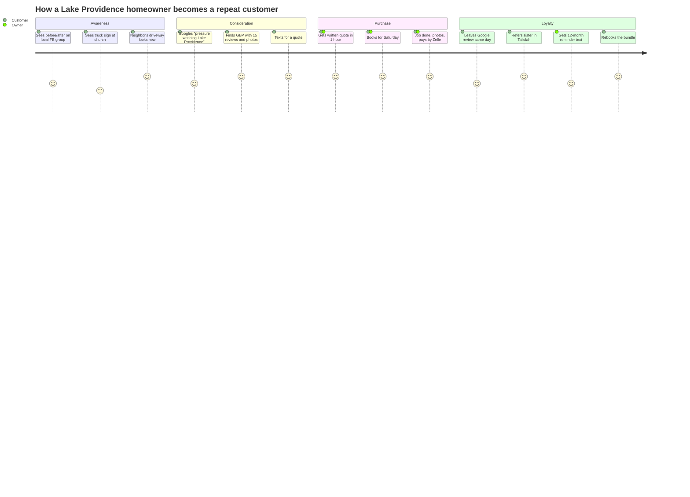

# 7. Marketing & Sales

## The strategy in one line

In a town of 3,000, the first 20 customers come from people who already know your name; the next 200 come from Google reviews and before/after photos on Facebook.

## Customer journey

## Launch plan: first 20 customers

| Week | Action | Cost | Expected jobs |
|---|---|---|---|
| 0 | Wash your own house, Dad's house, and two relatives' driveways. Photograph everything. These are your portfolio. | Chemicals only | 0 (but 4 photo sets) |
| 1 | Set up Google Business Profile with 20 photos, services, hours, and service area. Post on your personal Facebook and every local community group (Lake Providence, Tallulah, Oak Grove, Lake Village buy/sell/trade groups). | $0 | 3–5 |
| 1 | Offer "founder pricing": first 10 customers get the Curb Appeal bundle for $225 in exchange for a Google review and a yard sign for a week. | ~$50 margin each | 5–10 |
| 2 | Visit every church in Lake Providence and Tallulah in person with a flyer. Offer to do the first one at cost. | $20 printing | 2–3 |
| 2–4 | Door hangers on the 200 best-looking houses with the dirtiest driveways (drive the nice streets, you'll know). | $60 | 3–6 |
| 3 | Walk in to 10 gas stations / c-stores on US-65 and I-20 with a one-page commercial offer. | $0 | 1–2 recurring |
| 4 | Ask every completed customer: "Who else do you know that needs this?" and hand them 3 cards with your name on the back. | $0 | 2–4 |

## Channels, ranked by expected return

```mermaid
flowchart TD
    subgraph Free["Free, do first"]
        GBP[Google Business Profile<br/>reviews + photos]
        FB[Facebook: personal page,<br/>community groups, business page]
        WOM[Word of mouth:<br/>ask for referrals every job]
        CH[Churches and<br/>civic groups]
        SIGN[Yard sign at every job<br/>for 1 week]
    end
    subgraph Cheap["Under $100/mo"]
        DH[Door hangers in<br/>target neighborhoods]
        TRUCK[Truck / trailer signage]
        BOOST[Boosted FB before/after<br/>post, $20, 15-mile radius]
    end
    subgraph Later["Year 2"]
        NX[Nextdoor, if it has users here]
        LSA[Google Local Services Ads]
        RAD[Local radio spot<br/>KLPL / KBMQ / Delta stations]
    end
    GBP --> LEADS((Leads))
    FB --> LEADS
    WOM --> LEADS
    CH --> LEADS
    SIGN --> LEADS
    DH --> LEADS
    TRUCK --> LEADS
    BOOST --> LEADS
    NX -.-> LEADS
    LSA -.-> LEADS
    RAD -.-> LEADS
```

## Google Business Profile: the non-negotiable

- Category: "Pressure washing service." Secondary: "Cleaning service."
- Service area business (hide the home address). List every town: Lake Providence, Tallulah, Oak Grove, Delhi, Rayville, Bastrop, Eudora, Lake Village, Dermott, McGehee, Hamburg.
- Upload 5 new photos every week. GBP rewards activity.
- Get to **10 reviews in 30 days, 25 in 90.** Text the review link the same evening while the driveway is still wet. Script: "Thanks again! If you have 30 seconds, a Google review helps a small business more than anything: [link]."
- Reply to every review within a day.
- You will likely be the **only** listing for "pressure washing" in East Carroll, West Carroll, and Chicot County. That's the moat.

## Facebook playbook

- Before/after side-by-side photo, same angle, same time of day. That format sells itself.
- Post in community groups once a week max, always with a photo and a local address ("Driveway on Lake Street this morning"). Never post a price list; post results and "message me for a quote."
- Boost one post a month for $20 to a 15-mile radius, ages 30–65, homeowners. Track calls.
- Respond to messages inside 15 minutes during the day. Speed wins more jobs than price in a rural market.

## Commercial sales process

1. Identify 30 targets: gas stations, dollar stores, banks, clinics, restaurants, churches, farm supply stores, the parish/city offices, schools.
2. Walk in Tuesday–Thursday, 10am–2pm, ask for the owner or manager. Leave the one-page commercial sheet. Offer a free demo of one 10×10 section of sidewalk.
3. Pitch monthly or quarterly service, not a one-off. "I'll keep your entry looking new for $150 a month and you'll never have to think about it."
4. Follow up in 7 days. Then 30 days. Then put them on the quarterly check-in list.
5. Target: 3 recurring accounts by month 6 = $450–$600/month base that pays all fixed overhead.

## Pricing presentation

- Always give the price in writing (text or email). Verbal quotes get misremembered.
- Quote the bundle first, then the single service. Anchor high.
- Say "The house wash is $225 and I can add the driveway while I'm here for $110" rather than "driveway is $130, house is $225." The add-on framing lands the bundle.
- Never discount for "cash." It signals you're not serious and it's a tax problem.

## Branding basics

- Name: short, local, ownable. Candidates: Delta Pressure Washing, Lake Providence Pressure Washing, Carroll Parish Wash Co, 65 South Pressure Washing. Check Louisiana Secretary of State name availability and grab the matching Facebook and Google names.
- Logo: one color, readable on a truck sign from 50 feet. Fiverr or Canva, $0–$50.
- Phone: a dedicated Google Voice number ($0) so you can put it on everything and hand it off later.
- Uniform: clean logo shirt every job. It's the cheapest credibility you can buy.

## Retention

- 12-month reminder text to every residential customer: "It's been a year since we washed your house. Want me to come by? Same price as last time."
- Spring and fall "neighbor special": $25 off when two neighbors book the same day (saves you a drive, they save money).
- Christmas card or text to every commercial account. Small towns remember.
