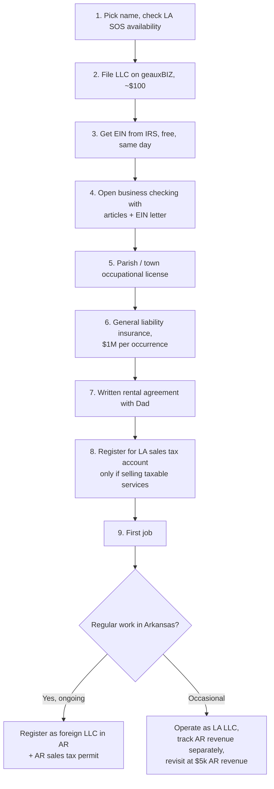

# 8. Legal & Compliance

This is a checklist, not legal advice. Fee amounts change; confirm each item with the agency before paying.

## Setup sequence

## Entity: Louisiana LLC

| Item | Detail |
|---|---|
| Where | geauxBIZ (Louisiana Secretary of State online portal) |
| Cost | $100 filing + small online fee. Annual report $30. |
| Registered agent | Yourself at a Louisiana street address. Free. |
| Operating agreement | Single-member; write a one-page one. Banks sometimes ask. |
| Why an LLC | Separates your personal truck and savings from a lawsuit if you strip paint off someone's house or a trailer comes unhitched. Costs $100. Do it. |

## Licenses and registrations

| Item | Who | Cost | Notes |
|---|---|---|---|
| Occupational license | East Carroll Parish (Police Jury / Sheriff's tax office) and Town of Lake Providence | $50–$150/yr | Based on gross receipts; the first year is a flat minimum. Ask the tax collector's office. |
| Occupational license, other parishes | Madison (Tallulah), West Carroll, Richland, Morehouse | Varies | Louisiana parishes can require an occupational license for anyone doing business in the parish. Many don't enforce on small mobile services. Ask once you're doing regular work there. |
| Louisiana state contractor license | LA State Licensing Board for Contractors | None needed | Pressure washing is not a licensed contractor trade in Louisiana. Residential work under $7,500 and commercial under $50,000 don't need one anyway. |
| Arkansas contractor license | AR Contractors Licensing Board | None needed | Cleaning is not construction. Jobs over $2,000 in AR require a license only for construction trades. |
| Louisiana sales tax | LA Dept of Revenue + parish | $0 to register | Cleaning real property (walls, concrete) is generally **not** a taxable service in Louisiana. Cleaning tangible personal property (vehicles, equipment) **may** be. Confirm with LDR before invoicing fleet work. |
| Arkansas sales tax | AR Dept of Finance & Administration | $0 to register | Arkansas taxes a list of specific services including **cleaning parking lots and gutters** and various cleaning/janitorial services. If you do recurring commercial work in AR, register and collect. |
| Arkansas foreign LLC registration | AR Secretary of State | ~$270–$300 | Required if "transacting business" in AR on an ongoing basis. Occasional jobs are a gray area; most solo operators register once AR becomes a steady part of revenue. |
| DOT / commercial vehicle | FMCSA / LA DOTD | None likely | A pickup + utility trailer under 10,001 lb GVWR combined and intrastate is exempt. Check the trailer's rating. |

## Insurance

| Policy | Required? | Cost | Notes |
|---|---|---|---|
| **General liability, $1M per occurrence / $2M aggregate** | Yes, before first paid job | $45–$90/mo | Covers damage to customer property (stripped paint, broken window, dead shrubs, water in the wall). Commercial accounts will ask for a certificate of insurance (COI). Quote Next Insurance, Thimble, Hiscox, biBERK, and a local independent agent or Farm Bureau. Make sure "pressure washing" and "soft washing / chemical application" are not excluded. |
| Commercial auto | If the truck is used primarily for business | $80–$150/mo | If the truck is Dad's or personal and occasionally used, a personal policy with a "business use" rider may be enough. Ask the agent; don't guess, because a personal policy can deny a claim that happened on a job. |
| Inland marine / equipment | Optional | $15–$30/mo | Covers the washer and gear if stolen off the trailer. Cheap once you own the washer. |
| Workers' comp | No | — | Not required for a single-member LLC with no employees in LA or AR. Required the day you hire. |
| Umbrella | No | — | Year 2+ if you take on larger commercial. |

**Get the COI and keep a PDF on your phone.** Hand it to every commercial customer before they ask.

## Contracts and paperwork

- **Written quote on every job** (text is fine). State: services, price, what's excluded, that oxidation and pre-existing stains may not come out, that you're not responsible for pre-existing damage noted in before-photos.
- **Commercial jobs: a one-page service agreement** with scope, frequency, price, payment terms (net 15), and a 30-day cancellation clause.
- **Equipment rental agreement with Dad**: see [`templates/equipment-rental-agreement.md`](../templates/equipment-rental-agreement.md).
- **Before/after photos on every job.** They are your legal defense and your marketing.

## Environmental

- EPA Clean Water Act: wash water with soap, grease, or chemicals is not supposed to enter storm drains. For residential house washes, direct runoff to grass. For gas stations and restaurants, block the drain and direct to landscaping or collect. Louisiana DEQ and Arkansas DEQ can fine for discharge, but enforcement on small operators is rare; the practical risk is a commercial customer whose property manager requires compliance.
- Sodium hypochlorite is a pool chemical, not a restricted pesticide, so no applicator license is needed to use it for cleaning. Don't market it as "mold remediation" or "disinfecting," which carry different rules.

## Tax calendar

| When | What |
|---|---|
| Every payment | Move 25% to tax savings |
| Apr 15, Jun 15, Sep 15, Jan 15 | Federal quarterly estimates (1040-ES) and Louisiana estimates |
| Jan 31 | 1099-NEC to Dad if you paid him $600+ in rent for the year (rent goes on 1099-MISC, box 1) |
| Annually by LLC anniversary | Louisiana annual report, $30 |
| Annually | Renew parish occupational license |
| Annually | Renew GL policy, update COI with commercial customers |
