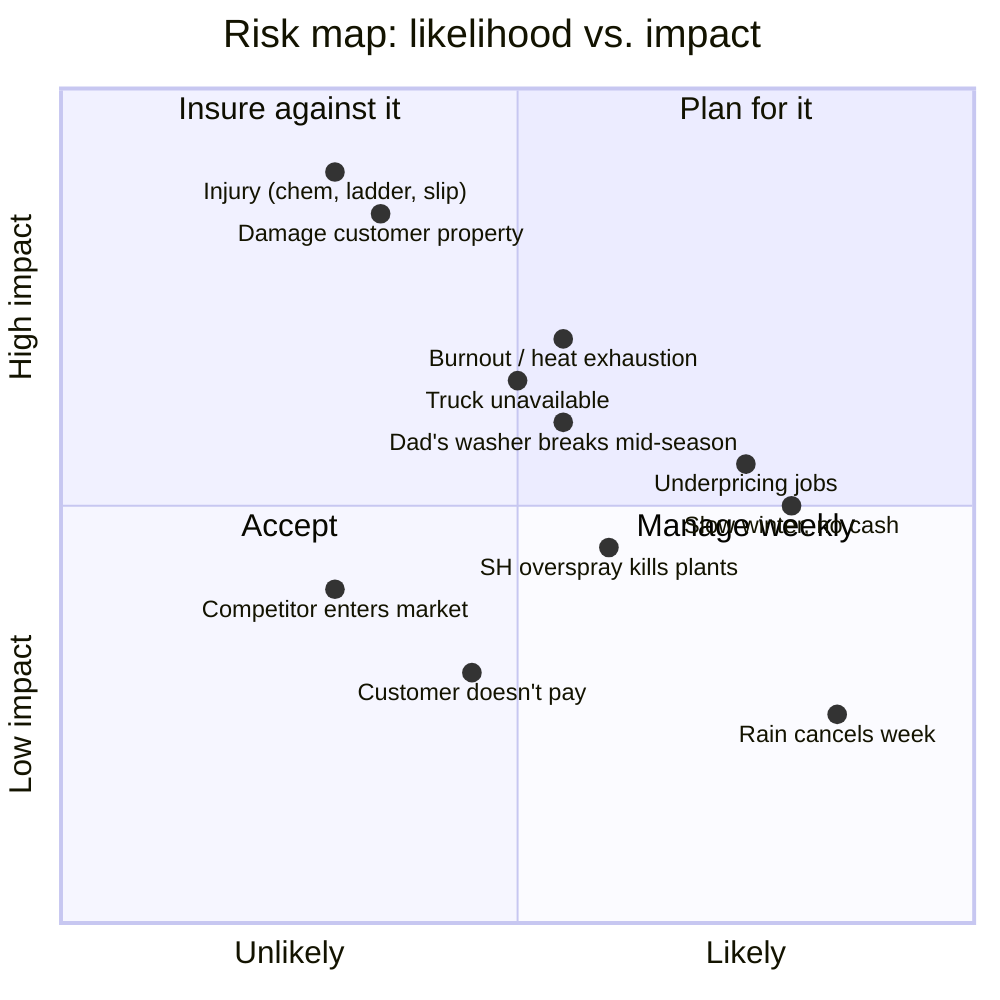

# 9. Risks & Mitigation

| Risk | Likelihood | Impact | Mitigation |
|---|---|---|---|
| **Damage to customer property** (stripped paint, etched concrete, water behind siding, broken window seal, dead plants) | Medium | High | Soft wash only on siding. Test spots. Pre-wet and rinse plants. Before photos. $1M GL policy. Clear exclusions on the quote. |
| **Injury**: chemical burns, ladder fall, slip on wet concrete, kickback from 0° tip | Low–Medium | Very high | Respirator and goggles every time. Never wash from a ladder. Never use 0° tip near people or skin. Non-slip boots. Keep the first aid kit and eyewash on the trailer. Health insurance. |
| **Washer failure** (rented unit, unknown maintenance history) | Medium | Medium–High | Check oil before every job. Keep $300 in reserve for a pump rebuild. Know the nearest rental yard (Monroe, Vicksburg) for a day-rental backup at ~$90/day. Plan to own a washer by month 12. |
| **Truck unavailable** | Medium | Medium | Gear fits in any pickup bed without the trailer. Line up a second vehicle (friend, rental) for peak weeks. |
| **Underpricing** | High early | Medium | Log time on every job. Review the hourly rate monthly. Raise prices 10% when booked 2 weeks out. Never match a handyman's price. |
| **Slow winter** | High | Medium | Build 3 recurring commercial accounts by fall. Push fleet and equipment work Nov–Feb. Save 15% of peak revenue as a winter cushion. |
| **Heat** (Delta July = 95°F + humidity) | High | Medium–High | Start at 6:30am, done by 1pm. Electrolytes. Two jobs max on 95°+ days. Know heat exhaustion signs. |
| **Rain** | High | Low | Rain-day list: covered fleet, shop floors, quotes, marketing, maintenance. |
| **Non-payment** | Medium | Low | Residential: payment on completion, photo before leaving. Commercial: net 15, deposit over $750, stop service when 30 days late. Small claims in parish court for anything over $300. |
| **Competitor shows up** (Monroe company expands east, or a local copies you) | Low–Medium | Medium | Reviews are the moat. 25+ Google reviews and a year of before/afters are hard to catch up to. Recurring commercial contracts lock in the base. |
| **Chem overspray on plants / cars / windows** | Medium | Low–Medium | Pre-wet, tarp, rinse twice. Move cars before starting. Rinse windows last. Carry a bottle of vinegar-water to neutralize spots. |
| **Burnout** (doing everything alone) | Medium | High | Cap at 5 jobs/day-equivalent per week in Year 1. Take Sundays. Use the slow winter to recover. The Year 3 decision point is real: solo is a job, a second rig is a business. |
| **Arkansas compliance gap** | Medium | Low | Track AR revenue separately from day one. Register as foreign LLC and for AR sales tax when AR recurring work passes ~$5k/yr. |
| **Family business friction** (rent disputes, washer condition) | Low–Medium | Medium | The written rental agreement. Pay Dad on the 1st, every month, by Zelle, with a note. Return the washer cleaner than you got it. |

## Kill criteria

Set these now so you're not deciding emotionally in August:

- **Month 3:** fewer than 15 total jobs and fewer than 5 Google reviews → the marketing isn't working; stop and fix the funnel before spending more.
- **Month 6:** effective hourly under $20 after logging real times → pricing or speed problem; fix before adding capacity.
- **Month 12:** under $12k revenue with full effort → treat it as a side business, don't buy the washer.
