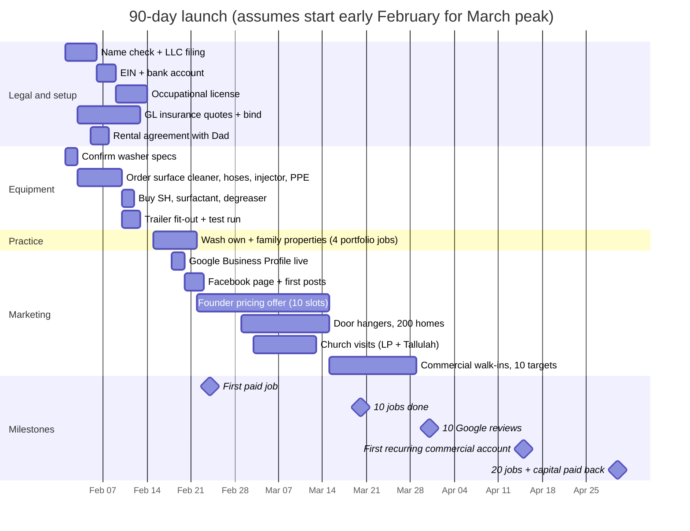
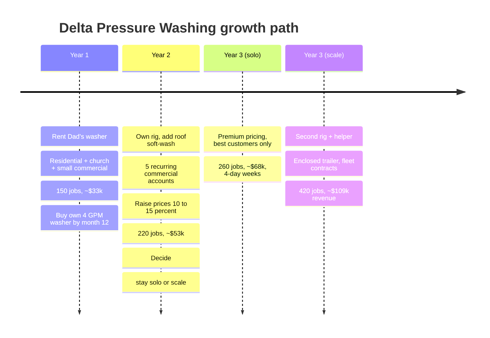
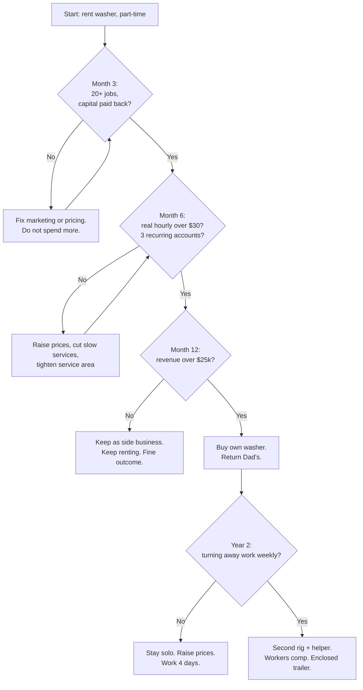

# 10. Roadmap

## 90-day launch plan

Dates above assume a February 2027 start. If you launch earlier (e.g. this fall), shift everything; the sequence matters more than the dates. An October start still catches the post-harvest equipment season and fall house washes before the winter lull.

## Year 1 milestones

| Month | Milestone | Why it matters |
|---|---|---|
| 1 | Legal, insured, 4 portfolio photos, GBP live | Can legally take money |
| 2 | 10 jobs, 10 reviews | Google starts ranking you |
| 3 | 20 jobs, startup capital paid back, 1 recurring commercial | Business is self-funding |
| 4–6 | 15+ jobs/month, 3 recurring accounts, pricing raised 10% | Fixed costs covered by recurring alone |
| 6 | Review job log: real hourly rate, best services, best towns | Decide what to stop offering |
| 7–9 | Harvest-season farm push: 10 equipment jobs | Highest-ticket work of the year |
| 10–12 | Winter: fleet, commercial, gutters. Buy own washer if revenue > $25k. | Dad gets his washer back; variable cost halves |
| 12 | Year-end: 150+ jobs, $30k+ revenue, 40+ reviews, customer list of 120 | Base for Year 2 |

## Three-year arc

## Decision gates

## This week

1. Ask Dad for the washer's make, model, PSI, GPM, and whether it's an axial or triplex pump.
2. Check the trailer's GVWR sticker and the hitch rating on the truck.
3. Check name availability at the Louisiana Secretary of State and lock the matching Facebook page name.
4. Get two GL insurance quotes online (takes 10 minutes each).
5. Price a 20" surface cleaner and 100 ft hose for that washer's GPM.
6. Wash your own driveway and photograph it before and after. You now have a portfolio.
